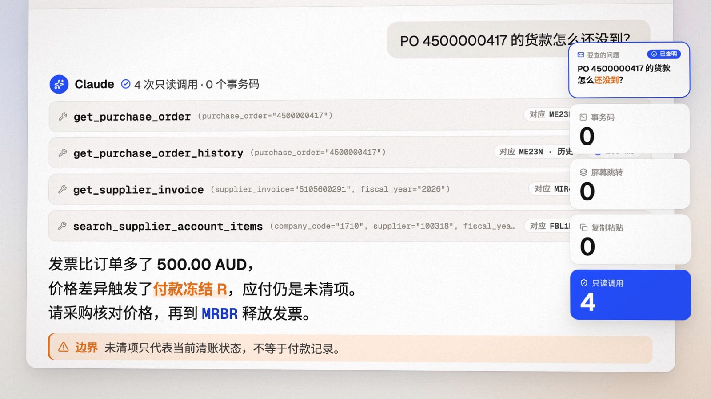

<div align="center">


# SAP Data MCP

**Ask your S/4HANA in one sentence.**

Read-only MCP servers that let Claude and other AI assistants query SAP S/4HANA through RFC/BAPI, private-cloud OData or public-cloud released APIs

[中文](README.md) · [Quick start](#quick-start) · [Full promo video](https://github.com/wangyichuan0609-tech/sap-data-mcp/releases/latest) · [MIT License](LICENSE)

</div>

**In one sentence:** if your AI assistant were a new colleague, SAP Data MCP would be its **read-only account plus an operating manual**. It can look up orders, invoices, stock and supplier open items in SAP on its own and give you the answer in a sentence, but it cannot change any data, never sees your passwords, and every lookup is on record.



## Quick start

You need Python 3.12 and an AI tool that supports MCP, such as Claude Desktop, Claude Code or Cursor. The example uses the public-cloud API server (Windows PowerShell):

```powershell
git clone https://github.com/wangyichuan0609-tech/sap-data-mcp.git
cd sap-data-mcp
py -3.12 -m venv .venv
.\.venv\Scripts\python.exe -m pip install -r requirements.txt
Copy-Item .env.example public_cloud\api\.env
```

1. Open `public_cloud\api\.env` and set the system address `SAP_API_BASE_URL`, then either Basic authentication (`SAP_API_USERNAME`, `SAP_API_PASSWORD`) or OAuth client credentials (`SAP_API_AUTH=oauth`, `SAP_API_TOKEN_URL`, `SAP_API_CLIENT_ID`, `SAP_API_CLIENT_SECRET`). The private-cloud OData server works the same way in `private_cloud\odata`.
2. Register the server with your AI tool, using your own paths:

   ```json
   {
     "mcpServers": {
       "sap_public_api": {
         "command": "C:\\sap-data-mcp\\.venv\\Scripts\\python.exe",
         "args": ["C:\\sap-data-mcp\\public_cloud\\api\\server.py"]
       }
     }
   }
   ```

   In Claude Code it is one line: `claude mcp add sap_public_api -- C:\sap-data-mcp\.venv\Scripts\python.exe C:\sap-data-mcp\public_cloud\api\server.py`
3. Have the assistant call `health_check` and `test_sap_api_connection(service="material")` to confirm the connection, then ask in plain language, for example *"Why hasn't PO 4500000417 been paid yet?"*

> On-premise and private-cloud systems reached over RFC/BAPI also need the SAP NW RFC SDK and PyRFC; follow [GOLDEN_PATH.md](private_cloud/rfc/docs/GOLDEN_PATH.md). Each server reads its `.env`, `config/` and `logs/` from the folder of its own `server.py`, so absolute paths are all your AI tool needs.

## How it differs

| What you may have tried | The catch | SAP Data MCP |
|---|---|---|
| **Looking it up by hand in SAP GUI** (ME23N, MIR4, FBL1N…) | One question takes several T-codes, copying document numbers between screens, and a stop at *"Fill in all required entry fields"* | Ask in plain language; the assistant calls the matching standard read interfaces and answers once |
| **Writing your own RFC or OData scripts** | Every new question means new code, authentication and paging, and scripts often carry passwords | 412 ready-made read-only tools across the three servers, with authentication and paging handled; credentials stay in a local `.env` |
| **Giving the assistant an account or API that can write** | One misunderstanding can change data, and afterwards nobody can say what it did | The read-only whitelist is in the code, there is no write capability, and every call goes to the audit log |
| **Reading database tables directly** | You need to know table structures and field meanings, and raw rows easily miss business rules | Standard business interfaces first (BAPIs, standard OData services, released APIs), so results carry business meaning; the RFC table tools are a read-only supplement |

### In plain terms, the benefits

- **No T-codes to remember**: ask *"Why hasn't this PO been paid?"* and the assistant looks up the order, the invoice and the supplier's open items itself.
- **Read-only, so it cannot change data**: every RFC call must pass a whitelist of 98 standard read functions, and the HTTP servers send fixed GET requests (the only POST fetches an OAuth token). Nothing can create, change or post.
- **Passwords never pass through the assistant**: passwords, client secrets and tokens stay in the local `.env` and appear as `[REDACTED]` in errors and logs. No tool accepts credentials, arbitrary URLs or raw OData queries, and TLS verification stays on.
- **Every lookup on record**: each call is written to `logs/tool_calls_YYYY-MM-DD.jsonl` with its arguments, status, duration and the functions or API paths it used; `get_tool_call_log` reads it back.
- **Says so when it cannot find something**: every result carries a status of `ok`, `not_found`, `partial` or `error`. An empty list is not a zero balance, a missing authorization is not "no data", and a clearing reference is not proof of payment.
- **Every deployment covered**: on-premise and private cloud over RFC/BAPI or OData, public cloud over released APIs; each server keeps its own configuration, credentials and logs.
- **Works with the AI tools you already use**: Claude Desktop, Claude Code, Cursor and other MCP clients connect directly, with no extra platform or agent to build.

### What it does not do

To be clear about the boundaries: SAP Data MCP is **read-only** and never creates, changes, posts or approves documents. It calls standard SAP interfaces and **does not** drive SAP GUI or Fiori screens. It returns what SAP returns and **does not draw conclusions for you**; for example, it never treats a clearing reference as a payment record. It is not an SAP product, and what it can read depends on the services activated in the target system and the authorizations of the logon user.

## What's inside

| Server and client label | Runs against | Route | Read-only tools |
|---|---|---|---|
| [`private_cloud/rfc`](private_cloud/rfc/)<br>`sap_private_rfc` | S/4HANA Private Edition or on-premise with RFC; ECC / NetWeaver | RFC/BAPI via PyRFC and the SAP NW RFC SDK | 95, over 98 whitelisted RFC functions |
| [`private_cloud/odata`](private_cloud/odata/)<br>`sap_private_odata` | Private Edition or on-premise systems exposing the standard OData services | OData V2/V4 over HTTPS | 159 (155 business + 4 platform) |
| [`public_cloud/api`](public_cloud/api/)<br>`sap_public_api` | S/4HANA Cloud Public Edition | Released OData V4/V2 APIs over HTTPS | 158 (154 business + 4 platform) |

Together the three servers register 412 read-only tools (many names are shared between servers) across eight standard areas: MM/IM, PP, SD, WM/EWM, FI, CO, master data / MDG and QM. The RFC server adds Basis and interface monitoring (ST22, SM21, SLG1, SM37, IDocs, qRFC/tRFC/bgRFC queues, Gateway service registration), read-only table and source display, and a runner for reviewed display-only reports. Module-by-module coverage, interface sources and known gaps: [docs/COVERAGE.md](docs/COVERAGE.md).

## Example questions

- *"Why hasn't PO 4500000417 been paid yet?"* The order, its PO history, the supplier invoice and the supplier's open items.
- *"Which short dumps hit the system today?"* `list_short_dumps` (RFC).
- *"Were any background jobs canceled since this morning?"* `list_background_jobs` (RFC).
- *"Show inbound IDocs in error from the last three days."* `list_idocs` (RFC).
- *"How much of material 4000123 is in plant 1010, by storage location and batch?"* `search_material_stock` on RFC, `get_material_stock` on the HTTP servers.
- *"Which open items does supplier 100318 have in company code 1710?"* `search_supplier_account_items`.

Results keep SAP's own field names, keys, amounts, units and currencies, including zero and false values. Lists page with `max_results` and `offset`. Monitoring times are SAP application-server local time, as SAP GUI shows them.

## Repository layout

```text
sap-data-mcp/
├── private_cloud/
│   ├── rfc/          RFC/BAPI server (PyRFC + SAP NW RFC SDK)
│   └── odata/        Private-cloud OData server
├── public_cloud/
│   └── api/          Public-cloud released-API server
├── shared/           OData client and business-domain tools shared by the HTTP servers
├── tests/            Offline regressions against SAP-shaped fixtures, no SAP logon
├── docs/             Coverage reference and promo media
├── requirements.txt  Shared HTTP/MCP dependencies; the RFC server adds PyRFC
└── .env.example      Configuration template for the HTTP servers
```

## Documentation

- [docs/COVERAGE.md](docs/COVERAGE.md): coverage by module, interface choices with official SAP references, and known boundaries.
- [private_cloud/rfc/README.md](private_cloud/rfc/README.md): RFC tools and the SAP functions behind them, required authorizations and audit-log fields (Chinese).
- [private_cloud/rfc/docs/GOLDEN_PATH.md](private_cloud/rfc/docs/GOLDEN_PATH.md): RFC setup from Python to the first call (Chinese).
- [private_cloud/odata/README.md](private_cloud/odata/README.md) and [public_cloud/api/README.md](public_cloud/api/README.md): service mappings for the HTTP servers (Chinese).

## Tests

The offline regressions in `tests/` run against SAP-shaped fixtures and never log on to SAP. The RFC tests import PyRFC, so run the suite where the RFC requirements are installed:

```powershell
.\.venv\Scripts\python.exe -m unittest discover -s tests
```

To add an RFC function, first confirm that it is a standard read-only function, then add it to `READ_ONLY_FUNCTIONS`; the connector rejects any function that is not on the list.

## Disclaimer

Independent open-source project, not affiliated with or endorsed by SAP SE. SAP, S/4HANA and other SAP product names are trademarks of SAP SE. Business data in the promo film is fictional.

## License

[MIT](LICENSE)
