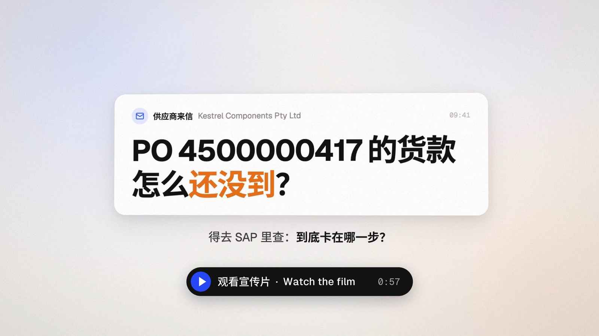

<div align="center">

# SAP Data MCP

**Ask SAP S/4HANA in plain language. Read-only, audited, and your credentials stay local.**

Three [Model Context Protocol](https://modelcontextprotocol.io) servers that let an AI assistant read S/4HANA through RFC/BAPI, private-cloud OData and public-cloud released APIs.

English · [简体中文](README.zh-CN.md)

[](LICENSE)
[](#quick-start)
[](https://modelcontextprotocol.io)
[](#safety-by-design)

<a href="https://github.com/wangyichuan0609-tech/sap-data-mcp/releases/tag/promo-film"></a>

<sub>57-second film · 1080p60 · Chinese on-screen text · opens the release page with the MP4 download</sub>

</div>

## Why

> **"Why hasn't PO 4500000417 been paid yet?"**

One supplier email like this sends you through SAP GUI: ME23N for the order, MIR4 for the invoice, FBL1N for the supplier's open items. You copy document numbers from screen to screen and go back for the fiscal year after *"Fill in all required entry fields"*. In the film, answering this one question takes 15 T-codes, 138 keystrokes and 4 copy-pastes.

With SAP Data MCP, the assistant makes the same standard reads itself:

| Instead of | The assistant calls |
|---|---|
| ME23N (order) | `get_purchase_order` |
| ME23N (PO history) | `get_purchase_order_history` |
| MIR4 (invoice) | `get_supplier_invoice` |
| FBL1N (supplier open items) | `search_supplier_account_items` |

Four read-only calls, no T-codes. The answer in the film: *the invoice is 500.00 AUD above the order, the price variance set payment block R and the payable is still open; ask purchasing to check the price, then release the invoice in MRBR.* It also states what the data cannot prove: an open item shows clearing status, not a payment record.

## What's inside

| Server and client label | Runs against | Route | Read-only tools |
|---|---|---|---|
| [`private_cloud/rfc`](private_cloud/rfc/)<br>`sap_private_rfc` | S/4HANA Private Edition or on-premise with RFC; ECC / NetWeaver | RFC/BAPI via PyRFC and the SAP NW RFC SDK | 95, over 98 whitelisted RFC functions |
| [`private_cloud/odata`](private_cloud/odata/)<br>`sap_private_odata` | Private Edition or on-premise systems exposing the standard OData services | OData V2/V4 over HTTPS | 159 (155 business + 4 platform) |
| [`public_cloud/api`](public_cloud/api/)<br>`sap_public_api` | S/4HANA Cloud Public Edition | Released OData V4/V2 APIs over HTTPS | 158 (154 business + 4 platform) |

Together the three servers register 412 read-only tools (many names are shared between servers) across eight standard areas: MM/IM, PP, SD, WM/EWM, FI, CO, master data / MDG and QM. The RFC server adds Basis and interface monitoring (ST22, SM21, SLG1, SM37, IDocs, qRFC/tRFC/bgRFC queues, Gateway service registration), read-only table and source display, and a runner for reviewed display-only reports.

Each server runs on its own, with its own configuration, credentials, MCP registration and audit log. The two HTTP servers share the business-domain code in [`shared/`](shared/) and never load PyRFC. All three read through standard SAP interfaces; none of them drives SAP GUI or Fiori screens.

Module-by-module coverage, interface sources and known gaps: [docs/COVERAGE.md](docs/COVERAGE.md).

## Safety by design

- **Read-only by construction.** Every RFC call has to pass `READ_ONLY_FUNCTIONS`, the whitelist of 98 standard read functions in [`sap_rfc_connector.py`](private_cloud/rfc/connectors/sap_rfc_connector.py); the connector rejects anything else. The HTTP servers send fixed GET requests, and their only POST fetches an OAuth token. No tool creates, changes or posts data.
- **Credentials stay on your machine.** Passwords, client secrets and tokens live in each server's own `.env` and are masked as `[REDACTED]` in errors and logs. No tool accepts credentials, arbitrary URLs or raw OData queries, and TLS verification stays on.
- **Every call on the record.** Each tool call appends one JSON line to `logs/tool_calls_YYYY-MM-DD.jsonl` with its arguments, status, duration and the RFC functions or API paths it used; `get_tool_call_log` reads it back.
- **Honest results.** Every result carries a `status` of `ok`, `not_found`, `partial` or `error`. An empty list is not a zero balance, a missing authorization is not "no data", and a clearing reference is not proof of payment. The tools return what SAP returned and infer nothing beyond it.
- **No login retries.** Each RFC server process logs on to SAP once, and the HTTP servers stop after an HTTP 401 instead of retrying, so a wrong password is not retried into a locked account.

## Quick start

You need Python 3.12 and an MCP client that runs local stdio servers, such as Claude Desktop, Claude Code or Cursor. The RFC server also needs the SAP NW RFC SDK and PyRFC; [GOLDEN_PATH.md](private_cloud/rfc/docs/GOLDEN_PATH.md) walks through that setup.

**1. Install** (Windows PowerShell, from the repository root):

```powershell
py -3.12 -m venv .venv
.\.venv\Scripts\python.exe -m pip install -r requirements.txt
# RFC server only, after installing the SAP NW RFC SDK:
.\.venv\Scripts\python.exe -m pip install -r private_cloud\rfc\requirements.txt
```

**2. Configure** the server you need:

| Server | Configuration |
|---|---|
| RFC | In `private_cloud/rfc/`, copy `.env.example` to `.env` (`SAP_USERNAME`, `SAP_PASSWORD`) and `config/SAP_SYSTEM_INFO.example` to `config/SAP_SYSTEM_INFO` (application server, system number, client). |
| Private OData or Public API | Copy the root `.env.example` to `private_cloud/odata/.env` or `public_cloud/api/.env`. Set `SAP_API_BASE_URL`, then either Basic authentication (`SAP_API_USERNAME`, `SAP_API_PASSWORD`) or OAuth client credentials (`SAP_API_AUTH=oauth`, `SAP_API_TOKEN_URL`, `SAP_API_CLIENT_ID`, `SAP_API_CLIENT_SECRET`). |

**3. Register** the servers with your MCP client. Each server finds its `.env`, `config/` and `logs/` next to its own `server.py`, so absolute paths are all the client needs:

```json
{
  "mcpServers": {
    "sap_private_rfc": {
      "command": "C:\\sap-data-mcp\\.venv\\Scripts\\python.exe",
      "args": ["C:\\sap-data-mcp\\private_cloud\\rfc\\server.py"]
    },
    "sap_public_api": {
      "command": "C:\\sap-data-mcp\\.venv\\Scripts\\python.exe",
      "args": ["C:\\sap-data-mcp\\public_cloud\\api\\server.py"]
    }
  }
}
```

In Claude Code: `claude mcp add sap_public_api -- C:\sap-data-mcp\.venv\Scripts\python.exe C:\sap-data-mcp\public_cloud\api\server.py`

**4. Check the connection**, then start asking: call `health_check` and `get_server_info`, then `test_sap_rfc_connection` once per session on RFC, or `test_sap_api_connection(service="material")` on the HTTP servers.

## Example questions

- *"Why hasn't PO 4500000417 been paid yet?"* The order, its PO history, the supplier invoice and the supplier's open items.
- *"Which short dumps hit the system today?"* `list_short_dumps` (RFC).
- *"Were any background jobs canceled since this morning?"* `list_background_jobs` (RFC).
- *"Show inbound IDocs in error from the last three days."* `list_idocs` (RFC).
- *"How much of material 4000123 is in plant 1010, by storage location and batch?"* `search_material_stock` on RFC, `get_material_stock` on the HTTP servers.
- *"Which open items does supplier 100318 have in company code 1710?"* `search_supplier_account_items`.

Results keep SAP's own field names, keys, amounts, units and currencies, including zero and false values. Lists page with `max_results` and `offset`. Monitoring times are SAP application-server local time, as SAP GUI shows them.

## Repository layout

```text
sap-data-mcp/
├── private_cloud/
│   ├── rfc/          RFC/BAPI server (PyRFC + SAP NW RFC SDK)
│   └── odata/        Private-cloud OData server
├── public_cloud/
│   └── api/          Public-cloud released-API server
├── shared/           OData client and business-domain tools shared by the HTTP servers
├── tests/            Offline regressions against SAP-shaped fixtures, no SAP logon
├── docs/             Coverage reference and media
├── requirements.txt  Shared HTTP/MCP dependencies; the RFC server adds PyRFC
└── .env.example      Configuration template for the HTTP servers
```

## Documentation

- [docs/COVERAGE.md](docs/COVERAGE.md): coverage by module, interface choices with official SAP references, and known boundaries.
- [private_cloud/rfc/README.md](private_cloud/rfc/README.md): RFC tools and the SAP functions behind them, required authorizations and audit-log fields (Chinese).
- [private_cloud/rfc/docs/GOLDEN_PATH.md](private_cloud/rfc/docs/GOLDEN_PATH.md): RFC setup from Python to the first call (Chinese).
- [private_cloud/odata/README.md](private_cloud/odata/README.md) and [public_cloud/api/README.md](public_cloud/api/README.md): service mappings for the HTTP servers (Chinese).

## Development

The offline regressions in `tests/` run against SAP-shaped fixtures and never log on to SAP. The RFC tests import PyRFC, so run the suite where the RFC requirements are installed:

```powershell
.\.venv\Scripts\python.exe -m unittest discover -s tests
```

To add an RFC function, first confirm that it is a standard read-only function, then add it to `READ_ONLY_FUNCTIONS`; the connector rejects any function that is not on the list.

## Disclaimer

Independent open-source project, not affiliated with or endorsed by SAP SE. SAP, S/4HANA and other SAP product names are trademarks of SAP SE. Business data in the film is fictional.

## License

[MIT](LICENSE)
