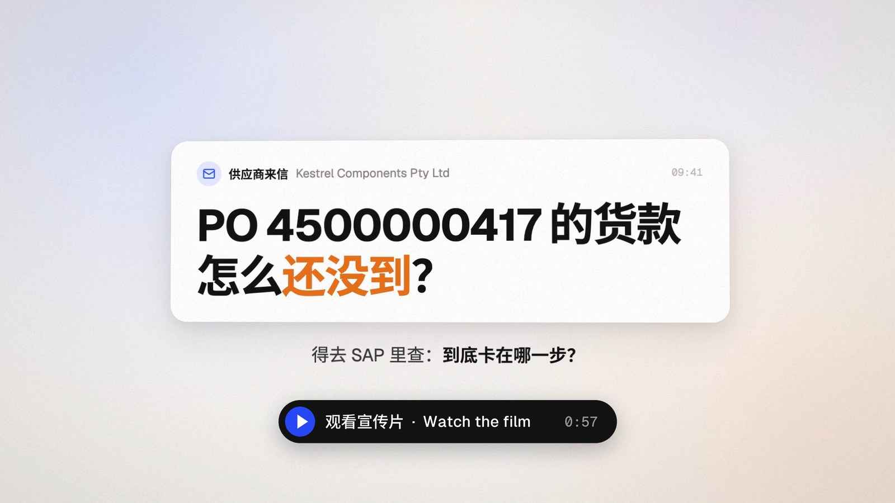

<div align="center">

# SAP Data MCP

**一句话，读懂你的 S/4HANA。只读、可审计，凭证只留在本机。**

三个 [Model Context Protocol](https://modelcontextprotocol.io) 服务，让 AI 助手通过 RFC/BAPI、私有云 OData 和公有云 Released API 读取 SAP S/4HANA。

[English](README.md) · 简体中文

[](LICENSE)
[](#快速开始)
[](https://modelcontextprotocol.io)
[](#安全设计)

<a href="https://github.com/wangyichuan0609-tech/sap-data-mcp/releases/tag/promo-film"></a>

<sub>57 秒宣传片 · 1080p60 · 点击打开 Release 页面下载 MP4</sub>

</div>

## 为什么做这个

> **「PO 4500000417 的货款怎么还没到？」**

供应商来一封这样的邮件，在 SAP GUI 里就得先开 ME23N 看订单，再去 MIR4 查发票、FBL1N 看供应商未清项，单号在几个屏幕之间来回复制，碰上「填写所有必填字段」还要回头补会计年度。片子里为了回答这一个问题，一共开了 15 个事务码，按了 138 次键，复制粘贴 4 次。

接上 SAP Data MCP 之后，这些标准读取由 AI 助手自己完成：

| 原来要开的事务码 | AI 助手调用的只读 Tool |
|---|---|
| ME23N（订单） | `get_purchase_order` |
| ME23N（订单历史） | `get_purchase_order_history` |
| MIR4（发票） | `get_supplier_invoice` |
| FBL1N（供应商未清项） | `search_supplier_account_items` |

4 次只读调用，0 个事务码。片中的回答是：「发票比订单多了 500.00 AUD，价格差异触发了付款冻结 R，应付仍是未清项。请采购核对价格，再到 MRBR 释放发票。」同时写明边界：未清项只代表当前清账状态，不等于付款记录。

## 包含什么

| 服务和客户端标签 | 适用系统 | 接入方式 | 只读 Tool |
|---|---|---|---|
| [`private_cloud/rfc`](private_cloud/rfc/)<br>`sap_private_rfc` | 开放 RFC 的 S/4HANA Private Edition、On-Premise；ECC / NetWeaver | RFC/BAPI，PyRFC + SAP NW RFC SDK | 95 个，基于 98 项 RFC 函数白名单 |
| [`private_cloud/odata`](private_cloud/odata/)<br>`sap_private_odata` | 开放标准 OData 服务的 Private Edition、On-Premise | OData V2/V4 over HTTPS | 159 个（155 业务 + 4 基础） |
| [`public_cloud/api`](public_cloud/api/)<br>`sap_public_api` | S/4HANA Cloud Public Edition | Released OData V4/V2 API over HTTPS | 158 个（154 业务 + 4 基础） |

三个服务合计注册 412 个只读 Tool（不同服务之间有不少同名 Tool），覆盖 8 大标准模块：MM/IM、PP、SD、WM/EWM、FI、CO、主数据 / MDG、QM。RFC 服务另有 Basis 和接口监控（ST22、SM21、SLG1、SM37、IDoc、qRFC/tRFC/bgRFC 队列、Gateway 服务注册），以及只读查表、只读查看源码和运行已审核的只显示报表。

每个服务独立运行，配置、凭证、MCP 注册和审计日志都分开。两个 HTTP 服务共用 [`shared/`](shared/) 里的业务实现，不加载 PyRFC。三个服务都只走 SAP 标准接口，不自动操作 SAP GUI 或 Fiori 页面。

各模块的详细覆盖、接口来源和已知缺口见 [docs/COVERAGE.md](docs/COVERAGE.md)（英文）。

## 安全设计

- **只读写在代码里。** 每个 RFC 调用都必须通过 [`sap_rfc_connector.py`](private_cloud/rfc/connectors/sap_rfc_connector.py) 里的白名单 `READ_ONLY_FUNCTIONS`（98 个标准读取函数），不在名单上的一律拒绝。HTTP 服务只发固定的 GET 请求，唯一的 POST 是获取 OAuth token。没有任何 Tool 会创建、修改或过账数据。
- **凭证只留在本机。** 密码、client secret 和 token 只存在各服务自己的 `.env` 里，在错误信息和日志中显示为 `[REDACTED]`。没有 Tool 接受凭证、任意 URL 或原始 OData 查询，TLS 校验始终开启。
- **每次调用都有记录。** 每次 Tool 调用都会往 `logs/tool_calls_YYYY-MM-DD.jsonl` 追加一行 JSON：参数、状态、耗时，以及用到的 RFC 函数或 API 路径；用 `get_tool_call_log` 可以回看。
- **查不到就说查不到。** 每个结果都带 `status`：`ok`、`not_found`、`partial` 或 `error`。空列表不等于余额为零，缺权限不等于没有数据，清账参考不等于实际付款。Tool 只返回 SAP 给的数据，不做推断。
- **不会反复重试登录。** RFC 服务每个进程只登录一次 SAP，HTTP 服务遇到 401 就停下、不重试，密码填错也不会因为反复重试把账号锁掉。

## 快速开始

需要 Python 3.12，以及能运行本地 stdio 服务的 MCP 客户端，例如 Claude Desktop、Claude Code 或 Cursor。RFC 服务还需要 SAP NW RFC SDK 和 PyRFC，安装步骤见 [GOLDEN_PATH.md](private_cloud/rfc/docs/GOLDEN_PATH.md)。

**1. 安装**（Windows PowerShell，在仓库根目录执行）：

```powershell
py -3.12 -m venv .venv
.\.venv\Scripts\python.exe -m pip install -r requirements.txt
# 仅 RFC 服务需要，先装好 SAP NW RFC SDK：
.\.venv\Scripts\python.exe -m pip install -r private_cloud\rfc\requirements.txt
```

**2. 配置**要用的服务：

| 服务 | 配置 |
|---|---|
| RFC | 在 `private_cloud/rfc/` 里，把 `.env.example` 复制为 `.env`（`SAP_USERNAME`、`SAP_PASSWORD`），把 `config/SAP_SYSTEM_INFO.example` 复制为 `config/SAP_SYSTEM_INFO`（应用服务器、系统编号、集团）。 |
| 私有 OData 或公有云 API | 把根目录的 `.env.example` 复制为 `private_cloud/odata/.env` 或 `public_cloud/api/.env`。填写 `SAP_API_BASE_URL`，再选 Basic 认证（`SAP_API_USERNAME`、`SAP_API_PASSWORD`）或 OAuth 客户端凭证（`SAP_API_AUTH=oauth`、`SAP_API_TOKEN_URL`、`SAP_API_CLIENT_ID`、`SAP_API_CLIENT_SECRET`）。 |

**3. 注册**到 MCP 客户端。每个服务都从自己 `server.py` 所在的目录读取 `.env`、`config/` 和 `logs/`，客户端只要写绝对路径即可：

```json
{
  "mcpServers": {
    "sap_private_rfc": {
      "command": "C:\\sap-data-mcp\\.venv\\Scripts\\python.exe",
      "args": ["C:\\sap-data-mcp\\private_cloud\\rfc\\server.py"]
    },
    "sap_public_api": {
      "command": "C:\\sap-data-mcp\\.venv\\Scripts\\python.exe",
      "args": ["C:\\sap-data-mcp\\public_cloud\\api\\server.py"]
    }
  }
}
```

Claude Code 里：`claude mcp add sap_public_api -- C:\sap-data-mcp\.venv\Scripts\python.exe C:\sap-data-mcp\public_cloud\api\server.py`

**4. 检查连接**，然后就可以提问了：先调用 `health_check` 和 `get_server_info`，RFC 服务每个会话调用一次 `test_sap_rfc_connection`，HTTP 服务调用 `test_sap_api_connection(service="material")`。

## 可以这样问

- 「PO 4500000417 的货款怎么还没到？」：订单、订单历史、供应商发票、供应商未清项。
- 「今天系统里有哪些短转储？」：`list_short_dumps`（RFC）。
- 「今天早上以来有没有被取消的后台作业？」：`list_background_jobs`（RFC）。
- 「列出最近三天出错的入站 IDoc。」：`list_idocs`（RFC）。
- 「物料 4000123 在 1010 工厂各库存地点、各批次有多少库存？」：RFC 用 `search_material_stock`，HTTP 服务用 `get_material_stock`。
- 「供应商 100318 在公司代码 1710 下有哪些未清项？」：`search_supplier_account_items`。

结果保留 SAP 原始的字段名、键、金额、单位和币种，零值和 false 也照样返回。列表用 `max_results` 和 `offset` 分页。监控类时间是 SAP 应用服务器本地时间，与 SAP GUI 显示一致。

## 目录结构

```text
sap-data-mcp/
├── private_cloud/
│   ├── rfc/          RFC/BAPI 服务（PyRFC + SAP NW RFC SDK）
│   └── odata/        私有云 OData 服务
├── public_cloud/
│   └── api/          公有云 Released API 服务
├── shared/           两个 HTTP 服务共用的 OData 客户端和业务 Tool
├── tests/            基于 SAP 形态样例数据的离线回归测试，不登录 SAP
├── docs/             覆盖范围说明和宣传素材
├── requirements.txt  HTTP / MCP 共用依赖；RFC 服务另加 PyRFC
└── .env.example      HTTP 服务的配置模板
```

## 文档

- [docs/COVERAGE.md](docs/COVERAGE.md)：按模块列出的覆盖范围、接口选择及 SAP 官方出处、已知边界（英文）。
- [private_cloud/rfc/README.md](private_cloud/rfc/README.md)：RFC Tool 及对应的 SAP 函数、所需权限、审计日志字段。
- [private_cloud/rfc/docs/GOLDEN_PATH.md](private_cloud/rfc/docs/GOLDEN_PATH.md)：RFC 从安装 Python 到第一次调用的完整步骤。
- [private_cloud/odata/README.md](private_cloud/odata/README.md) 和 [public_cloud/api/README.md](public_cloud/api/README.md)：两个 HTTP 服务的服务映射。

## 开发

`tests/` 里的离线回归测试使用 SAP 形态的样例数据，不登录 SAP。RFC 部分的测试会导入 PyRFC，请在装好 RFC 依赖的环境里运行：

```powershell
.\.venv\Scripts\python.exe -m unittest discover -s tests
```

新增 RFC 函数时，先确认它是标准只读函数，再加入 `READ_ONLY_FUNCTIONS`；不在名单上的函数会被 Connector 直接拒绝。

## 声明

独立开源项目，与 SAP SE 无隶属关系，也未获其认可。SAP、S/4HANA 及其他 SAP 产品名称是 SAP SE 的商标。片中业务数据为演示虚构。

## 许可证

[MIT](LICENSE)
